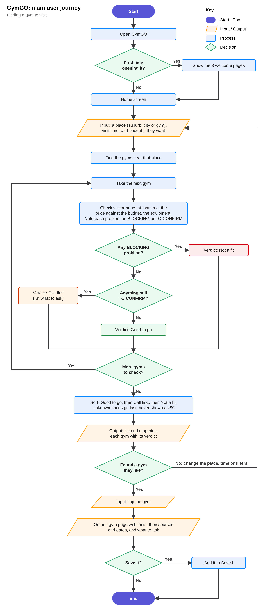

| | |
|---|---|
| Team | Ashen, Liam |
| Class / teacher | [Class], [Teacher] |
| Solution type | App (iPhone, Android and web browser) |
| Date | [Submission date] |

GymGO is an app for finding a gym you can visit without being a member, and then planning and logging a workout there. Most gyms don't say online whether visitors can come in, what one visit costs or what equipment they have, so GymGO shows what each gym has published, says where it came from, and marks everything else as unknown with a list of things to ask. It's aimed at travellers, students and anyone trying a gym before joining.

Acknowledgement: parts of the code and this report were written with help from an AI coding assistant.

# Task 1: Problem analysis

## Functional requirements

| No | Requirement |
|---|---|
| FR01 | The user can search for gyms by suburb, city or gym name. |
| FR02 | Gyms near the search are shown on a map and in a list, with their distance. |
| FR03 | The user can filter by visit time, budget and equipment. |
| FR04 | Each gym gets a verdict for the chosen time: Good to go, Call first or Not a fit. |
| FR05 | Each gym has a page with its price, visitor hours, member hours and equipment, and where each fact came from. |
| FR06 | Facts a gym hasn't published show as Unknown (never $0 or "no"), with questions to ask the gym. |
| FR07 | A signed-in user can save gyms and compare two side by side. |
| FR08 | The user can make an account, sign in and sign out. |
| FR09 | The user can build a workout by tapping muscles on a body diagram, and gets exercises with sets, reps and rest. |
| FR10 | The user can log a workout (weight and reps for each set), with a rest timer. |
| FR11 | The app tracks personal records, a weekly goal and workout history. |
| FR12 | An assistant (GymPal) answers questions about gyms and training. |

## Non-functional requirements

| No | Requirement |
|---|---|
| NFR01 | Usability: someone new can find a gym and open its page in under 60 seconds without help. |
| NFR02 | Speed: search results appear within 2 seconds. |
| NFR03 | Portability: one codebase runs on iPhone, Android and in a web browser. |
| NFR04 | Screen sizes: every screen works from 320 px wide up, with no sideways scrolling or overlapping text. |
| NFR05 | Accessibility: every button has a name a screen reader can read, and text has at least 4.5:1 contrast. |
| NFR06 | Robustness: missing data and wrong input (a bad password, a place that can't be found) get a clear message, not a crash. |
| NFR07 | Security: passwords are stored as hashes, never as plain text. |
| NFR08 | Cost: it only uses free services. |

## Constraints

- Time: about four weeks of class time, with a demo to another team each Friday.
- Team: two people (Ashen and Liam), so the work is split by feature.
- Budget: $0. Maps, weather and gym locations come from free services (OpenFreeMap, MET Norway, OpenStreetMap). Without a paid Apple Developer account it can't go on the App Store.
- Tools: we used TypeScript with React Native and Expo instead of one of the suggested tools, which needs the teacher's OK.
- Data: most gyms don't publish visitor prices or hours, and we won't make them up, so a lot of the app says "unknown".
- Privacy and legal: accounts and locations are personal information and some users may be under 18; OpenStreetMap data needs a licence credit; gym names are trademarks.

# Task 2: Plan and design

## Flowchart

The flowchart follows the main thing people do in GymGO: searching for a gym and deciding whether to go. For each nearby gym the app checks visitor hours, price and equipment. Anything that rules the gym out makes it Not a fit, anything unknown makes it Call first, and otherwise it's Good to go.

{ width=62% }

## Test plan

We ran these on 10 November 2026 in a phone-sized browser window with the real gym data. Screenshots are in the `test-evidence` folder.

| Test description | Input | Expected result | Actual result | Suggested fix (if required) |
|---|---|---|---|---|
| T1. Search for a suburb (FR01, FR02, FR04, NFR02) | Type Fitzroy in the search box and press Enter. | "Near Fitzroy" with gyms on the map and in the list, each with a verdict, within 2 seconds. | Pass. 91 gyms, all with a verdict, in 1.2 seconds. | The map label still said "Melbourne". We changed it to show the place searched. |
| T2. A gym with no published price (FR05, FR06, NFR06) | Open 101Fitness, Melbourne. | Price shows as Unknown, never $0. Verdict is Call first, with questions to ask. | Pass. Price was Unknown, verdict Call first, with 4 questions to ask. | None. |
| T3. Build a workout (FR09) | Tap Chest and Triceps on the body, then Build my workout. | A plan with sets, reps and rest for each exercise. | Pass. 6 exercises appeared after 3.4 seconds (the 3-second loading bar is on purpose). | Shorten the loading bar if testers find it slow. |
| T4. Narrowest screen (NFR04) | Open Home, Explore, Workout, Profile and a gym page at 320 px wide. | No sideways scrolling, nothing overlapping, no errors. | Pass on all 5 screens. | None. |

# Task 3: Development

| Part | Tool |
|---|---|
| Language | TypeScript |
| App | React Native with Expo |
| Maps | MapLibre with OpenFreeMap tiles |
| Server and database | Node.js with SQLite |
| Testing | Vitest for automated tests, Playwright for checking screens in a browser |
| Version control | Git and GitHub |

The app has four tabs (Home, Explore, Saved and Profile), a page for each gym, and the workout builder and log. A small server handles accounts, saved gyms and workouts. 23 Melbourne gyms were researched from their own websites; about 3,000 more come from OpenStreetMap with fewer details.

## Weekly demos

| Week | Team we showed | Feedback | What we changed |
|---|---|---|---|
| 1 | | | |
| 2 | | | |
| 3 | | | |
| 4 | | | |

# Task 4: Test and evaluate

## User testing

Each peer gets about 10 minutes with no help from us. We ask them to find a gym in Fitzroy they could visit at 6 pm and open its page (timed, for NFR01), say what they'd ask the gym, then build a chest workout and log one set. Afterwards we ask what was confusing and how easy it was from 1 to 5.

| Peer | Time to find a gym | Problems seen | Comments | Ease (1 to 5) |
|---|---|---|---|---|
| 1. [name] | | | | |
| 2. [name] | | | | |
| 3. [name] | | | | |

We also ran 1,236 automated tests (all passing) and checked 24 screens at 320 px wide with no errors. GymGO hasn't been tried on a real phone yet, only in the browser.

## Evaluation matrix

| FR/NFR code | Was the requirement met? | Reflections (where required) |
|---|---|---|
| FR01 | Met | T1 |
| FR02 | Met | T1 |
| FR03 | Met | |
| FR04 | Met | T1, T2 |
| FR05 | Partly | Only the 23 researched gyms have full details. The rest need gyms or members to add them. |
| FR06 | Met | T2 |
| FR07 | Met | Up to 10 saved gyms on the free plan. |
| FR08 | Met | |
| FR09 | Met | T3 |
| FR10 | Met | |
| FR11 | Met | |
| FR12 | Partly | GymPal is built but needs an API key on the server before it can answer. |
| NFR01 | [After user testing] | |
| NFR02 | Met | 1.2 seconds in T1 |
| NFR03 | Partly | Runs in the browser; the phone versions build but haven't been tried on a real phone. |
| NFR04 | Met | T4 |
| NFR05 | Partly | Automated checks pass, but we haven't tried it with VoiceOver or TalkBack. |
| NFR06 | Met | T2 |
| NFR07 | Met | |
| NFR08 | Met | |

Most requirements are met in the browser. What's left mostly needs a real phone (NFR03, NFR05) or something from outside the team, like gyms publishing their details (FR05) or an API key (FR12). Next we'd test on phones with Expo Go and run the peer tests.

# ReadMe / product page

See `README-Product-Page.md`, included in the ZIP: features, controls, known issues and how to run GymGO.
