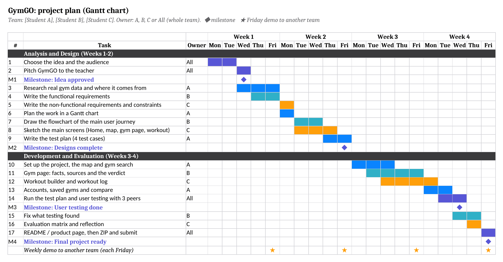

| | |
|---|---|
| **Team** | [Student A], [Student B], [Student C] |
| **Class / teacher** | [Class], [Teacher] |
| **Solution type** | App (iPhone, Android and web browser) |
| **Date** | [Submission date] |

**What GymGO is.** GymGO helps you find a gym you can actually walk into when you're not a member, and then plan and log your workout there. Gyms rarely publish whether a visitor can come in, what one visit costs or what equipment they have. GymGO shows what each gym *has* published, with where it came from and when it was checked, says plainly what is unknown, and tells you what to ask when you call.

**Audience.** People who want to train at a gym they don't belong to: travellers, students, people trying a gym before joining, and anyone who wants a simple way to build and track workouts.

> **Acknowledgement.** Parts of GymGO's code, its testing and this document were produced with help from an AI coding assistant. *[Edit this note so it says how your team used AI, as your school's policy asks.]*

# Task 1: Problem analysis (requirements)

## 1. Functional requirements

| No | Requirement | Notes |
|---|---|---|
| FR01 | GymGO shall let the user search for gyms by typing a suburb, city or gym name. | Search box on the Explore tab; press Enter or pick a suggestion. |
| FR02 | GymGO shall show the gyms near the searched place as pins on a map and as a list, with each gym's distance. | Pins close together are grouped into one numbered pin. |
| FR03 | GymGO shall let the user set a visit time, a budget and equipment they need as filters. | Filters button and the time and price chips. |
| FR04 | For every gym, GymGO shall give one verdict for the chosen visit time: *Good to go*, *Call first* or *Not a fit*. | The rule is in the flowchart (Task 2) and in `packages/domain/src/search.ts`. |
| FR05 | GymGO shall list *Good to go* gyms first, then *Call first*, then *Not a fit*. When sorting by price, gyms with an unknown price go last. | An unknown price is never treated as $0. |
| FR06 | GymGO shall show a page for each gym with the price of one visit, visitor (guest) hours, member hours, equipment and facilities, each with its source and the date it was checked. | Visitor hours and member hours are kept separate. |
| FR07 | Where a gym hasn't published a fact, GymGO shall show it as *Unknown* or *Not published* and list the questions to ask the gym. | Never shown as $0, "no" or a guess. |
| FR08 | GymGO shall let a signed-in user save gyms (up to 10 on the free plan) and see them on the Saved tab. | GymGO Pro raises the limit. |
| FR09 | GymGO shall let the user compare 2 gyms side by side on the free plan (up to 4 with Pro), row by row. | Rows include price, guest hours, booking, ID and distance. |
| FR10 | GymGO shall let the user create an account with an email address and password, sign in and sign out. | |
| FR11 | GymGO shall let the user build a workout by tapping muscles on a body figure and choosing a goal and a length, then show a plan with each exercise's sets, reps and rest. | Can use the kit a chosen gym is known to have. |
| FR12 | GymGO shall let the user swap an exercise in a plan for another that trains the same muscles. | *Swap* button on each exercise. |
| FR13 | GymGO shall let the user log a workout: enter the weight and reps of each set and tick it when done, which starts a rest timer. | |
| FR14 | GymGO shall keep personal records (such as the heaviest weight lifted) and show progress: workouts this week against a weekly goal, weeks in a row, milestones and history. | Progress page. |
| FR15 | GymGO shall show which muscles were trained recently on a recovery map of the body. | |
| FR16 | GymGO shall offer ready-made workout templates and multi-week training programmes. | Templates page. |
| FR17 | GymGO shall let the user check in at a gym when their location shows they are there, adding the gym to a card collection. | |
| FR18 | GymGO shall let the user choose a light, dark or automatic appearance and an accent colour. | Profile → Appearance. |
| FR19 | GymGO shall keep an offline copy of gyms so that search still works without an internet connection. | |
| FR20 | GymGO shall let the user report a bug, choosing whether to include device details. | Profile → Report a bug. |
| FR21 | GymGO shall offer an AI assistant (GymPal) that answers questions about gyms and training once it has an API key, and say it is being set up until then. | The key is kept on the server, never in the app. |

## 2. Non-functional requirements

| No | Requirement | Notes |
|---|---|---|
| NFR01 | **Usability:** a first-time user can find a gym near a given suburb and open its page within 60 seconds, without help. | Timed during user testing (Task 4). |
| NFR02 | **Response time:** search results for a suburb appear within 2 seconds. | Measured in test T1. |
| NFR03 | **Response time:** a built workout plan appears within 4 seconds of tapping *Build my workout*. | Includes a deliberate 3-second loading bar. |
| NFR04 | **Portability:** one codebase runs on iPhone, Android and in a web browser on a computer or phone. | React Native with Expo. |
| NFR05 | **Responsiveness:** every screen works at widths from 320 to 1280 points with no sideways scrolling and no overlapping text. | 320 points is the narrowest common phone. Measured in test T4. |
| NFR06 | **Accessibility:** every button and control has a name a screen reader can read out; body text meets WCAG 2.1 AA contrast (at least 4.5:1); animations stop when the device's Reduce Motion setting is on. | |
| NFR07 | **Reliability:** no crashes or page errors on the 24 main screens during testing. | |
| NFR08 | **Robustness:** missing data is shown as unknown, never as $0, "no" or a guess; wrong input (such as a wrong password or a place that can't be found) gets a clear message, not a crash. | Measured in test T2. |
| NFR09 | **Data accuracy:** every gym fact shows its source and the date it was checked; prices and hours older than 30 days are flagged for a recheck. | Facts from OpenStreetMap are labelled community-reported. |
| NFR10 | **Security and privacy:** passwords are stored only as scrypt hashes, never as plain text; progress photos stay on the device; searches are rate-limited to stop misuse. | |
| NFR11 | **Maintainability:** the code is TypeScript with type checking, and at least 1,000 automated tests pass before each release (`pnpm verify`). | |
| NFR12 | **Cost:** GymGO runs on free services only, with no paid API needed to run it. | Maps: OpenFreeMap. Weather: MET Norway. |

## 3. Constraints

- **Time.** 4–5 weeks of class time, shared with other subjects, with a demo to another team at the end of each week.
- **Team.** 2–3 students with different amounts of programming experience, so the work is split by feature (search and map; gym page; workouts).
- **Budget: $0.** Everything must be free: map tiles from OpenFreeMap, weather from MET Norway, gym locations from OpenStreetMap, and a free AI model for GymPal. A paid Apple Developer membership isn't available, so GymGO can't go on the App Store or add an iPhone home-screen widget.
- **Development tools.** GymGO is built with TypeScript, React Native and Expo, not one of the suggested tools such as MIT App Inventor, so the choice needs the teacher's approval. Testing on phones uses the free Expo Go app, which can't connect to Apple Health.
- **Data.** Most gyms don't publish visitor hours, single-visit prices or equipment. GymGO must not invent prices, reviews or hours, so much of what it shows is honestly "unknown".
- **Legal and ethical.** Gym names and logos are trademarks; OpenStreetMap data needs its licence credit (ODbL); location, photos and accounts are personal information, and some users may be under 18. No gym can be contacted without permission.
- **Hardware and network.** School laptops and the school network may block some services, and only a few real phones are available for testing.
- **Secrets.** GymPal needs an API key, which must stay on the server and must never be put in the code or shared.

# Task 2: Plan and design

## Gantt chart

The plan covers four weeks in two phases: *Analysis and Design* (Weeks 1–2) and *Development and Evaluation* (Weeks 3–4). It has 17 tasks, a demo to another team every Friday, and four milestones: **Idea approved** (Week 1), **Designs complete** (Week 2), **User testing done** (Week 4) and **Final project ready** (Week 4).

The spreadsheet is `GymGO-Gantt.xlsx` (open it in Excel or Google Sheets). Owners A, B and C match the team list; *All* means the whole team. Change the days to fit your class calendar.

{ width=100% }

## Design tool: flowchart

The flowchart shows GymGO's main user journey, finding a gym to visit, from **Start** to **End**:

- **Input:** the place, visit time and budget; later, which gym the user taps.
- **Processing:** for each nearby gym, GymGO checks visitor hours, price and equipment, and notes each problem as *blocking* or *to confirm*.
- **Decisions:** *First time opening it?*, *Any blocking problem?*, *Anything still to confirm?*, *More gyms to check?*, *Found a gym they like?* and *Save it?*
- **Loops:** one goes round every nearby gym; the other lets the user change the place, time or filters and search again.
- **Output:** the sorted list and map pins, then the gym's page.

It follows the real rule in `packages/domain/src/search.ts`. The same rule is written as pseudocode in the appendix.

{ width=72% }

## Test plan

Each test is mapped to the requirements it checks. The *Actual result* column was filled in when the developers ran these tests on 10 November 2026, in a phone-sized browser window, against GymGO's real gym data. The peer tests are in Task 4.

| Test description | Input | Expected result | Actual result | Suggested fix (if required) |
|---|---|---|---|---|
| **T1. Search for a suburb.** (FR01, FR02, FR04, NFR02) | Explore tab: type *Fitzroy* in the search box and press Enter. | The list is titled "Near Fitzroy", with gyms on the map and in the list. Every gym shows a verdict. Results appear within 2 seconds. | **Pass.** "Near Fitzroy: 91 gyms nearby". All 91 gyms showed a verdict, and results appeared in 1.2 seconds. | The map's corner label still said the city ("Melbourne"). It could show the suburb searched. **Fixed after testing:** it now shows the place searched ("Fitzroy"). |
| **T2. A gym that hasn't published its price.** (FR06, FR07, NFR08) | Open the page for 101Fitness, Melbourne. | The price shows as *Unknown* or *Not published*, never $0. The verdict is *Call first*, with questions to ask. | **Pass.** The price tile said *Unknown* and the Prices row *Not published*, with no "$0" anywhere. The verdict was *Call first*, with 4 questions: still open? walk in at 1 pm? cost of one visit? book ahead? | None. |
| **T3. Build a workout.** (FR11, NFR03) | Build a workout: tap *Chest* and *Triceps* on the body, then tap *Build my workout*. | Within 4 seconds, a plan titled "Chest, Triceps" appears, and each exercise shows its sets, reps and rest. | **Pass.** The plan appeared after 3.4 seconds (the 3-second loading bar is deliberate): 6 exercises, 23 sets, about 45 minutes. Each showed sets × reps and rest, for example 4 × 8–10 reps, 90 seconds rest. | None. If testers find the bar slow, it could be shortened. |
| **T4. The narrowest phone screen.** (NFR05, NFR07) | Open Home, Explore, Workout, Profile and a gym's page at 320 points wide. | No screen scrolls sideways, nothing overlaps, and no errors appear. | **Pass.** None of the 5 screens scrolled sideways, with 0 page errors. A wider check of 24 screens at 320 points in dark mode was also clean. | None. |

Screenshots from these tests are in the `test-evidence` folder.

# Task 3: Development

## Tools used

| Part | Tool |
|---|---|
| Language | TypeScript |
| App (iPhone, Android, web) | React Native with Expo (SDK 58) and Expo Router |
| Maps | MapLibre with OpenFreeMap map tiles; Apple MapKit on iPhone |
| Server and database | Node.js with its built-in SQLite database |
| Gym data | 23 Melbourne gyms researched from their own websites (with sources), plus about 3,000 more from OpenStreetMap |
| Automated tests | Vitest (1,224 tests across 11 packages, all passing on 10 November 2026) |
| Browser testing | Playwright (screens checked at 320, 390 and 1280 points wide, light and dark) |
| Version control | Git and GitHub |

## How it is organised

- `apps/mobile`: the app's screens (Home, Explore, Saved, Profile, gym pages, Compare, Workout).
- `apps/server`: accounts, saved gyms, reviews and the API.
- `packages/domain`: the rules shared by everything, such as the verdict, prices and opening hours, with their tests.
- `packages/*-data`: the gym data and where each fact came from.

## Weekly demos to another team

*[Fill in after each Friday demo.]*

| Week | Team we showed | What we showed | Feedback we got | What we changed |
|---|---|---|---|---|
| 1 | | | | |
| 2 | | | | |
| 3 | | | | |
| 4 | | | | |

# Task 4: Test and evaluate

## User testing

*[Fill this in with at least 3 peers who are not in your team. Nothing below has been made up: the tables are left empty for your real sessions.]*

**How to run each session (about 10 minutes):**

1. Open GymGO on a laptop or phone. Don't show them how it works.
2. Ask them to: (a) find a gym in Fitzroy they could visit at 6 pm, and open its page, timing how long it takes (NFR01); (b) say what they would ask that gym before going; (c) build a chest workout and start it; (d) enter one set and tick it.
3. Watch and write down where they hesitate, what they tap by mistake, and anything that goes wrong.
4. Ask: *What was confusing? What would you change? How easy was it, from 1 (hard) to 5 (easy)?*

| Peer | Date | Time to find and open a gym (NFR01) | Tests passed (T1–T4) | Bugs or problems seen | Comments | Ease (1–5) |
|---|---|---|---|---|---|---|
| Peer 1: [name] | | | | | | |
| Peer 2: [name] | | | | | | |
| Peer 3: [name] | | | | | | |

**What we noticed overall:** *[Write a few sentences after the sessions.]*

## Developer testing already done

- **Automated tests:** 1,224 tests across all 11 packages, all passing (app 569, server 295, shared rules 197, website 39, gym data 124).
- **Every screen:** 24 screens opened at 320 points wide in dark mode, with no page errors and no sideways scrolling.
- **Accessibility:** no unnamed buttons on 10 key screens; the colour contrast check passes; animations stop with Reduce Motion on.
- **Not yet done:** GymGO hasn't been run on a real iPhone or Android phone, only in the browser and in automated checks.

## Evaluation matrix

| FR/NFR code | Was the requirement met? | Reflections (where required) |
|---|---|---|
| FR01 | Met | T1. |
| FR02 | Met | T1. |
| FR03 | Met | |
| FR04 | Met | T1, T2. |
| FR05 | Met | Covered by automated tests of the sorting rule. |
| FR06 | Partially met | The 23 researched Melbourne gyms show their facts with sources and dates. The other gyms come from OpenStreetMap with few details, which are labelled community-reported. Meeting this fully needs gyms (or their members) to supply prices and hours. |
| FR07 | Met | T2. |
| FR08 | Met | |
| FR09 | Met | Checked with two gyms side by side. |
| FR10 | Met | Covered by the server's account tests. |
| FR11 | Met | T3. |
| FR12 | Met | |
| FR13 | Met | |
| FR14 | Met | |
| FR15 | Met | |
| FR16 | Met | |
| FR17 | Partially met | Checking in works in the browser with the test account, which can check in from anywhere. A real check-in using a phone's location at a gym hasn't been tried. Next: test it at a real gym on a phone. |
| FR18 | Met | |
| FR19 | Partially met | GymGO keeps an offline copy of 811 gyms, but it hasn't been tried on a phone with no signal. Next: test in flight mode. |
| FR20 | Met | |
| FR21 | Partially met | GymPal is built, but it needs an API key before it can answer; until then it says it is being set up. Next: add a key on the server (never in the code). |
| NFR01 | *[Fill in after user testing]* | Measure each peer's time in the user-testing table. |
| NFR02 | Met | 1.2 seconds in T1. |
| NFR03 | Met | 3.4 seconds in T3. |
| NFR04 | Partially met | It runs in the browser, and the iPhone and Android versions build, but it hasn't been run on a real phone. Next: open it in Expo Go on an iPhone and an Android phone and repeat T1–T4. |
| NFR05 | Met | T4, plus a 24-screen check at 320 points. |
| NFR06 | Partially met | The automated checks pass (names, contrast, Reduce Motion), but it hasn't been tried with VoiceOver or TalkBack on a real phone. Next: do T1 and T3 with a screen reader. |
| NFR07 | Met | 0 page errors on 24 screens. |
| NFR08 | Met | T2, plus automated tests that unknown prices are never treated as $0. |
| NFR09 | Met | |
| NFR10 | Met | Passwords are hashed with scrypt; progress photos stay on the device; searches are rate-limited. |
| NFR11 | Met | 1,224 tests passing. |
| NFR12 | Met | Runs on free services. Paid extras (GymGO Pro payments) are optional and switched off. |

**Reflection.** GymGO meets most of its requirements in the browser. The gaps are mainly things that need a real phone (NFR04, NFR06, FR17, FR19) or information from outside the team: gyms publishing their details (FR06) and an API key for GymPal (FR21). Next we would test it on real phones in Expo Go, run the user tests with peers, and add facts as gyms or members supply them, without guessing.

# ReadMe / product page

See `README-Product-Page.md`, included in the ZIP: features, controls, known issues and how to run GymGO.

# Appendix: the verdict rule as pseudocode

*The flowchart is the design tool chosen above. This is the same core rule written in the style of the Victorian pseudocode guide, as an extra.*

```
BEGIN FindGyms(place, visitTime, budget, neededKit)
  gyms ← GymsNear(place)
  results ← empty list
  FOR EACH gym IN gyms
    problems ← empty list
    hours ← VisitorHours(gym, visitTime)
    IF hours = "closed to visitors" THEN
      Add (BLOCKING, "Not open to visitors then") to problems
    ELSE IF hours = "unknown" THEN
      Add (TO CONFIRM, "Can a visitor walk in then?") to problems
    ENDIF
    IF budget is set THEN
      price ← SingleVisitPrice(gym)
      IF price = "unknown" THEN
        Add (TO CONFIRM, "How much is one visit?") to problems
      ELSE IF price > budget THEN
        Add (BLOCKING, "Over your budget") to problems
      ENDIF
    ENDIF
    FOR EACH item IN neededKit
      IF gym is known not to have item THEN
        Add (BLOCKING, item + " missing") to problems
      ELSE IF it is not known whether gym has item THEN
        Add (TO CONFIRM, "Is there a " + item + "?") to problems
      ENDIF
    ENDFOR
    IF any problem is BLOCKING THEN
      verdict ← "Not a fit"
    ELSE IF any problem is TO CONFIRM THEN
      verdict ← "Call first"
    ELSE
      verdict ← "Good to go"
    ENDIF
    Add (gym, verdict, problems) to results
  ENDFOR
  Sort results: "Good to go", then "Call first", then "Not a fit"
  Display results as a list and as map pins
END FindGyms
```
